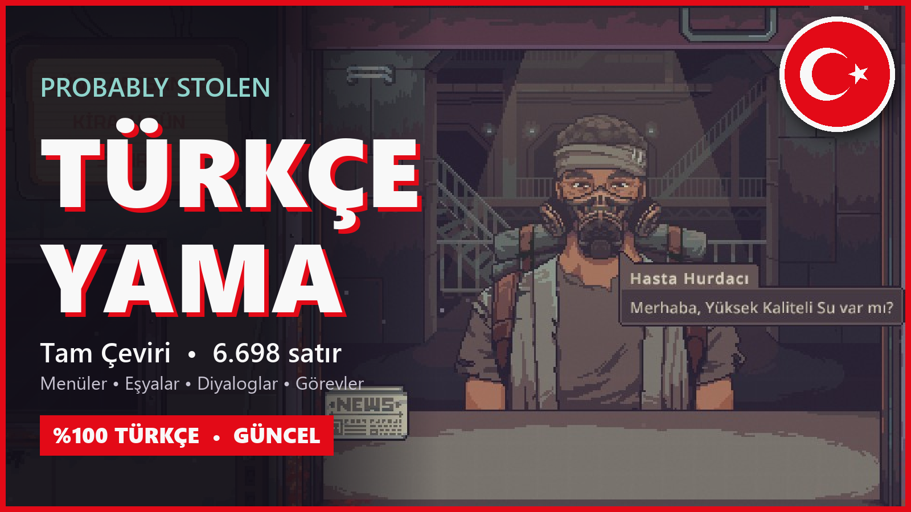

# Probably Stolen — Türkçe Yama (Tam Çeviri)



*Probably Stolen* oyununun tüm metinlerini (6.895 satır) Türkçeye çeviren hayran yaması: menüler, eşyalar, diyaloglar, avantajlar, ağ yükseltmeleri ve mekanik açıklamaları.

- Sürüm: **1.6**
- Desteklenen oyun sürümü: **0.46 / 0.46D** (7 Kasım 2026 güncellemesi dahil)
- Steam Workshop: https://steamcommunity.com/sharedfiles/filedetails/?id=3829264460

## Kurulum

### Steam Workshop (önerilen)
1. Workshop sayfasından abone ol.
2. Oyunu aç, **Mods** menüsünden **Türkçe Yama (Tam Çeviri)** modunu seç ve **Review and enable** ile etkinleştir.
3. Oyunu yeniden başlat. Oyun Türkçe açılır.
4. Açılmazsa ana menüdeki dil seçeneğinden **Türkçe** dilini seç (listenin en başında).

### Elle kurulum
1. Steam'de *Probably Stolen*'a sağ tık > **Yönet > Yerel dosyalara göz at**.
2. `Mods` klasörüne gir (yoksa oyunu bir kez açıp kapat).
3. Bu depodaki `TurkceYama` klasörünü olduğu gibi `Mods` içine kopyala:
   ```
   ...\Probably Stolen\Mods\TurkceYama\manifest.xml
   ...\Probably Stolen\Mods\TurkceYama\TurkceYama.dll
   ...\Probably Stolen\Mods\TurkceYama\tr.tsv
   ```
4. Oyunda Mods > **Türkçe Yama (Tam Çeviri)** > **Review and enable**, sonra oyunu yeniden başlat.

Workshop sürümüyle elle kurulan kopyayı aynı anda açık tutma.

## Bilmeniz gerekenler
- Yama, oyunun dil menüsünün en başına **Türkçe** ekler. İngilizce oynamak için menüden **English**'i seçmen yeterli; iki dil arasında oyunu yeniden başlatmadan geçebilirsin.
- Oyun yeni dil eklemeye izin vermediği için Türkçe, İngilizce metin tablolarının üzerine kurulur. Bu yüzden Türkçe seçiliyken diğer modlar kendi İngilizce metinlerini gösterir.
- Başka bir Türkçe yamayla aynı anda kullanma.
- Oyun dosyalarına dokunmaz; kaldırmak için modu kapatman ya da `Mods\TurkceYama` klasörünü silmen yeterli.
- Oyun güncellenip yeni metin gelirse, o satırlar çevrilene kadar İngilizce görünür.
- Çeviri yapay zekâ desteğiyle yapılmıştır. Hatalı ya da garip bir çeviri görürsen ekran görüntüsüyle bir Issue aç.

## Depo içeriği
| Yol | Ne |
|---|---|
| `TurkceYama/` | Oyuna kurulan hazır mod (manifest, DLL, çeviri) |
| `TurkceYama/tr.tsv` | Çeviri: her satır `Collection<TAB>KeyId<TAB>Metin`; `\n`, `\t`, `\\` kaçışlı, `#` yorum |
| `src/TurkishPatch.cs` | Türkçe seçiliyken oyunun English metin tablolarını `tr.tsv`'deki Türkçe metinle değiştirir, English seçilince orijinal metni geri koyar; eksik karakterler için oyunun yedek TMP fontunu ekler |
| `src/TurkishLanguage.cs` | Dil menüsünün başına Türkçeyi ekler ve "tr" seçimini English tabloları üzerinde Türkçe metne çevirir; önceki sürümün oyuncularını bir kez Türkçeye geçirir |
| `src/TurkishUiRefresher.cs` | Türkçe ile English arasında geçince oyunun ekrandaki metin bileşenlerini yeniler |
| `src/TurkishCase.cs` | TextMeshPro büyük/küçük harf dönüşümünü Türkçeye uygun yapar (i/İ, ı/I) |
| `tools/build_tsv.py` | Çevrilmiş parçaları İngilizce kaynağa göre doğrulayıp `tr.tsv` üretir |
| `docs/GLOSSARY.md` | Çeviri kuralları ve terimler sözlüğü |

## Derleme
DLL, oyunun `Probably Stolen_Data\Managed` klasöründeki derlemelere (Assembly-CSharp, UnityEngine.CoreModule, Unity.Localization, Unity.ResourceManager, Unity.TextMeshPro, 0Harmony) referans vererek `src/*.cs` dosyalarından derlenir. Oyunun DLL'leri bu depoda yer almaz.

## English
Full Turkish fan translation of *Probably Stolen* (6,895 lines). It adds Turkish (Türkçe) at the top of the game's language menu: activate the mod and restart the game. Pick English in the menu to switch back.

*Probably Stolen* ve tüm oyun içeriği Questing Goose Studio'ya aittir. Bu, resmî olmayan bir hayran çevirisidir.
